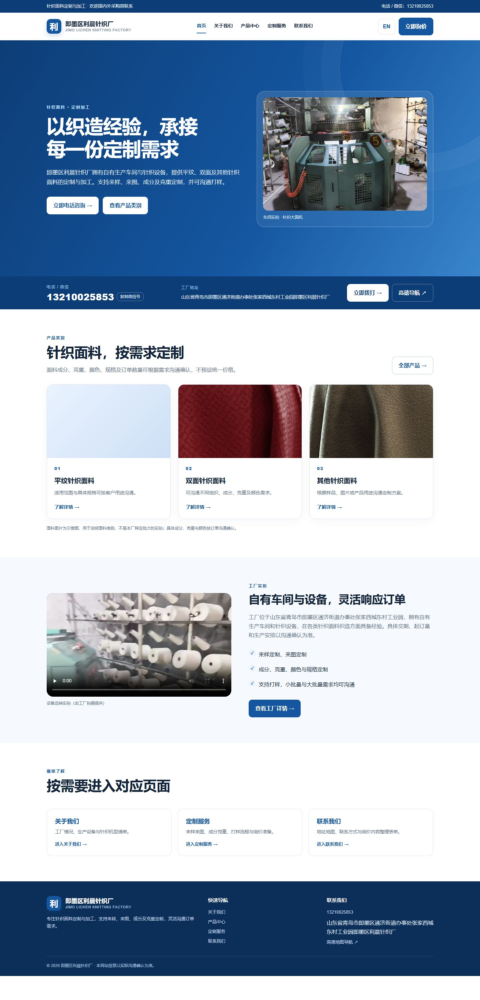

# 即墨区利晨针织厂官网 / Lichen Knitting Factory Website

即墨区利晨针织厂（青岛即墨）企业官网：面向国内外采购商展示自有车间、针织设备、三类针织面料与定制加工服务，引导客户通过电话 / 微信询价。

- **线上地址：<https://www.lichen-knitting.workers.dev>**
- 纯静态网站：无需后端、数据库或构建工具，上传即用
- 简体中文默认，支持切换商务英文（`?lang=en` 可直接打开英文版）
- 全部图片 / 视频本地化，不依赖任何外部 CDN



---

## 项目背景

这是一家真实的小型针织工厂（山东青岛即墨）的官网。工厂主营针织面料定制代工，
客户既有国内服装品牌和批发商，也有海外采购商，但此前**没有任何线上存在**——
客户只能靠熟人介绍和电话联系。

工厂的诉求很具体：

1. 让采购商能搜到、能看懂"这家厂能做什么面料"
2. 首页必须让人**立刻看到电话和地址**，不要藏在"联系我们"里
3. 中英文都要有，海外客户能看
4. 不要花哨的营销文案，不要编造产能和价格
5. 预算为零，不买服务器、不买建站服务

这个仓库就是按这些约束做出来的成品：一个**零依赖、零构建、零服务器**的静态站点。

---

## 开发过程

### 阶段一：接手与代码审计

项目是从一版早期初版静态站接手的。我没有直接在上面改，而是先把 9 个页面、
1 个样式表、1 个脚本全部读完，逐项记录问题，最后归纳出 8 类真实缺陷：

| # | 缺陷 | 后果 |
| --- | --- | --- |
| 1 | 询价文本里写的是 `"\\n"` 而不是 `"\n"` | 客户复制出来的内容是字面量反斜杠 n，粘贴到微信不能换行 |
| 2 | 7 个按钮的文字全靠 JS 写入，HTML 里是空标签 | JS 被拦截或未加载时，按钮完全空白 |
| 3 | CSS 定义了 `.navlinks a.active`，但没有任何代码设置它 | 导航栏永远没有"当前页"高亮 |
| 4 | 英文标题用 `replace()` 链拼接 | 输出成 `Jimo Lichen Knitting Factory \| 针织面料定制与加工`（一半中文） |
| 5 | 品牌副标题用内联 `style="display:block"` | 内联样式优先级高于媒体查询，移动端隐藏失效 |
| 6 | 页头在窄屏塞了 4 个元素 | 375px 下品牌名折成 3 行，"立即询价"被压成竖排 |
| 7 | 手机菜单点链接不关闭、不支持 Esc | 移动端交互不完整 |
| 8 | 产品图直接外链 Unsplash | 国内加载慢；而且这些图**内容错配**（一张是挂衣架，一张是水彩画），且随时可能失效 |

> 这一步的体会：AI 生成的页面"看起来能用"和"真的能用"之间有巨大差距，
> 必须逐个元素、逐个断点去验证，而不是看截图觉得差不多就交付。

### 阶段二：重建基础架构

没有在原文件上打补丁，而是写了一个生成器 `tools/gen_site.py`，把页面拆成
「公共 head + 公共页头 + 公共页脚 + 各页正文」，由同一份代码产出全部 9 个页面。
这样做的好处是**结构性问题不可能再出现**——不会出现"某页导航少一项""某页忘了加 meta"。

同时重写了 `assets/site.js`，核心改动：

- 语言切换改为**属性驱动**：所有可翻译文本写成 `data-zh` / `data-en` 双份，
  切语言时遍历替换，不再有字符串替换的脆弱逻辑
- 补上 `data-zh-alt` / `data-zh-aria` / `data-zh-placeholder`，让**图片 alt、无障碍标签、
  表单占位符**也跟随语言切换（原版这几项完全没处理）
- 移动菜单补齐 `aria-expanded` / `aria-controls`，支持点击外部、Esc、窗口变宽自动关闭
- 修复 `\n` 问题，并改为**只输出已填写的字段**（原版会输出一堆空行）
- 询价表单明确声明"不会发送"，并去掉了一切可能被误解为"发送成功"的文案

### 阶段三：补齐双语 SEO

每页独立撰写中英文 `title` / `description` / `keywords`，而不是共用一套。
补上 Open Graph、Twitter Card、canonical，并加入三类 JSON-LD 结构化数据：

- `LocalBusiness`（全站）：名称、电话、地址、服务区域
- `FAQPage`（定制服务页）：7 条问答，**与页面可见内容逐字一致**
- `BreadcrumbList`（内页）：对应页面上的面包屑

切换语言时，标题、描述、OG 标签、图片 alt 全部同步切换。

### 阶段四：真实素材接入（这一段最花时间）

客户提供了 2 张车间照片和 2 段手机拍的视频。照片是真实生产场面，直接可用；
但视频踩了一个大坑——

**视频是 H.265/HEVC 编码**（手机默认省空间的格式）。这个格式在 Chrome、Firefox
和绝大多数安卓浏览器上**根本放不出来**，访客只会看到黑框或静止封面。而环境里没有 ffmpeg。

解决方式是调用 Windows 自带的 Media Foundation：

- 用 PowerShell 5.1 的 WinRT 接口调 `MediaTranscoder`，把 HEVC 转成 H.264/AAC
- 中途踩了两个坑：`MediaComposition.Clips` 在 PowerShell 里无法投影（改用
  `StorageFile.GetThumbnailAsync` 绕开）；`TranscodeAsync()` 返回的是
  `IAsyncActionWithProgress` 而不是 `IAsyncAction`，等待方式要换
- 最终压到 **323 KB / 382 KB**（720p、900 kbps），任何浏览器都能播，并配了封面图

产品面料图则换成 **CC0（公共领域）真实面料照片**，来源是 Poly Haven（经 Wikimedia
Commons）。这里也有取舍：Commons 上合适的面料图多为 CC BY-SA（要求署名 + 相同方式共享），
对商业站点不够干净，所以只选 CC0 素材，并在 `CREDITS.md` 里完整记录来源。

> 页面上这三张图仍标注"示意图"，因为它们**不是本厂特定批次的实拍**。
> 真实性和美观冲突时，宁可标注清楚也不冒充。

### 阶段五：首页重构

客户明确反馈"不要做成下拉滚动式的网页"。原首页有 7 个区块、约 4.3 屏高，
确实像单页滚动的落地页风格。

重构为「**简短首页 + 子页面跳转**」：

- 首屏：标题 + 工厂实拍 + 两个按钮
- **紧接着一条深蓝色联系条**：大号电话、一键复制微信号、完整工厂地址、一键拨打、高德导航
- 然后只有三块：产品类别 → 工厂视频 → 三个子页面入口
- 设备清单、合作流程、询价准备、常见问题全部移到各自子页面，靠顶部导航跳转
- 首页高度从 4.3 屏压到 **约 2 屏**

### 阶段六：质量保障

因为交付物是纯静态文件，"肉眼看没问题"不足以交付，所以写了两个自动化手段：

**1. `tools/check_site.py`（静态自检）**

- 遍历所有页面，检查本地 `href` / `src` / `poster` / `<source>` 是否都能解析（0 死链）
- 检查 9 个页面的 title 与 description **是否两两重复**
- 检查是否存在"没有文字的空按钮"（阶段一缺陷 2 的回归测试）
- 校验所有 JSON-LD 是合法 JSON
- **扫描禁用表述**：邮箱、成立时间、产能、设备数量、固定价格、固定起订量、固定交期、
  免费打样、资质认证、客户案例、最佳性表述——防的是"编造经营数据"
- 校验图片 alt、表单是否声明"不会发送"
- 校验视频必须是 H.264（检测到 `hvc1`/`hev1` 直接报错）

**2. 浏览器交互自测（28 项）**

写了一个诊断页，把目标页面装进真实 390px 宽的 iframe 里跑检查：

- 9 个页面 × 390px / 1440px 两种宽度：**无横向溢出、页头保持单行**
- 9 个页面中英文切换：页面语言、标题、描述、一级标题均为纯英文，且无空白按钮
- 移动菜单可展开、`aria-expanded` 正确、展开后仍无溢出
- 询价表单提交后显示"不会发送"、无虚假成功提示、复制按钮可用

> 关键点：headless 浏览器直接设 `--window-size=390` 会**骗人**——它会把布局视口
> 悄悄钳到 ~500px 再裁图，看起来"内容被切掉了"。必须用 iframe 才能真正复现 390px 布局。
> 这个坑当时也误判了一轮。

### 阶段七：部署

先走 Cloudflare Pages，被账号邮箱验证拦住；验证后 Pages 接口仍拒绝，于是改用
**Workers 静态资源托管**——功能等价（免费、HTTPS、全球 CDN），
配置就是一段 `wrangler.toml` 指向静态目录。

部署后做的验证：

- 全部页面与资源返回 200，`404.html` 正确返回 404
- **下载线上 HTML 与本地文件比对 SHA256，完全一致**
- 写入 `canonical` / `og:url` / `sitemap.xml`，`robots.txt` 声明 Sitemap
- 删掉了 `robots.txt` 里指向内部调试页的 `Disallow`（会泄露内部路径）

### 阶段八：开源整理

上传前做了一轮敏感信息审计，剔除或处理了：

| 内容 | 处理 |
| --- | --- |
| Cloudflare OAuth 部署凭据、登录日志、授权链接 | 排除（`.deploy/` 整个目录不入库） |
| 账号邮箱、Account ID | 从文档中清除，部署说明重写为通用版本 |
| 本机绝对路径（含系统用户名） | 清除 |
| 内部交接文档、调试页 `_diag.html` | 排除 |
| `robots.txt` 中的内部调试路径 | 删除 |
| `.gitignore` | 覆盖 `node_modules`、`.deploy`、`.wrangler`、`*.log`、`.env`、密钥类文件 |

最终扫描确认：**无密钥、无账号信息、无本地路径**。

---

## 遇到的问题与解决（速查）

| 问题 | 根因 | 解决 |
| --- | --- | --- |
| 复制出的询价文本带 `\n` | JS 字符串里多写了一层转义 | 改为真实换行 |
| 按钮 JS 失效即空白 | 文案只由 JS 写入 | HTML 里补中文兜底 |
| 英文标题一半中文 | 用 `replace()` 链拼接 | 每页独立写英文标题 |
| 移动端副标题不隐藏 | 内联样式优先级高于媒体查询 | 改 CSS 类 |
| 视频不播放 | 素材是 H.265/HEVC | WinRT MediaTranscoder 转 H.264 |
| 产品图错配 / 打不开 | Unsplash 外链且内容不符 | 换 CC0 真实面料图，本地化 |
| 390px 截图内容被切 | headless 钳制最小窗口宽度 | 用 390px iframe 复现 |
| Pages 创建被拒 | 新账号邮箱未验证 | 验证邮箱后仍拒，改用 Workers |
| 子域名 `lichen` 被占用 | 全局唯一 | 改用 `lichen-knitting` |

---

## 技术决策与取舍

- **不用框架**：站点只有 9 个页面，React/Vue 会带来构建链和体积，收益为负。
- **不用构建工具**：直接写 HTML/CSS/JS，客户或任何开发者 clone 下来双击就能看。
- **图片全部本地化**：外链 CDN 在国内不稳定，且第三方图床随时可能失效。
- **视频必须转码**：为了兼容性牺牲一点画质，比"有一部分访客看不到"更重要。
- **不编造经营数据**：价格、MOQ、交期、产能一律"按实际沟通确认"，
  这不是偷懒，是避免虚假宣传和后续纠纷。
- **生成器覆盖手工编辑**：`gen_site.py` 会覆盖 HTML，但换来的是 9 个页面结构永不漂移。

---

## 技术栈

| 项目 | 说明 |
| --- | --- |
| 前端 | 原生 HTML5 + CSS3 + 原生 JavaScript（无框架、无构建步骤） |
| 国际化 | `data-zh` / `data-en` 属性驱动，`assets/site.js` 运行时切换并记忆选择 |
| SEO | 每页独立中英双语 title / description / keywords、Open Graph、Twitter Card、canonical、`sitemap.xml` |
| 结构化数据 | JSON-LD：`LocalBusiness`、`FAQPage`、`BreadcrumbList` |
| 托管 | Cloudflare Workers 静态资源托管（HTTPS + 全球 CDN，免费套餐） |

## 目录结构

```
├── lichen_knitting_website/     ← 网站本体（部署时上传这一层的内容）
│   ├── index.html               首页（简短首页 + 醒目联系条）
│   ├── about.html               关于我们（含车间实拍与视频）
│   ├── products.html            产品中心
│   ├── custom.html              定制服务（含常见问题）
│   ├── contact.html             联系我们（含询价整理表单）
│   ├── product-*.html           三个产品详情页
│   ├── 404.html
│   ├── assets/style.css         全站样式（分区注释、响应式）
│   ├── assets/site.js           语言切换 / 移动导航 / 表单整理 / 复制按钮
│   ├── assets/img/              工厂实拍照片、面料图、视频封面、图标
│   ├── assets/video/            工厂实拍视频（H.264）
│   ├── robots.txt / sitemap.xml / site.webmanifest
│   ├── CREDITS.md               图片与视频的来源与授权
│   └── README.md                站点详细说明
├── tools/                       构建与校验工具（不参与部署）
│   ├── gen_site.py              由同一份模板生成全部 9 个页面
│   ├── gen_assets.py            生成品牌图标 PNG
│   ├── check_site.py            静态自检（死链 / SEO / 空按钮 / 禁写内容）
│   └── set_domain.py            绑定域名后写入 canonical 并生成 sitemap
├── site.config.json             站点配置（当前生产域名）
└── docs/
    ├── 部署说明.md              本地预览、重新生成与部署步骤
    └── screenshot-home.jpg
```

## 本地预览

```bash
# 方式一：直接打开
#   Windows 下双击 lichen_knitting_website/preview-local.bat

# 方式二：任意静态服务器
cd lichen_knitting_website
python -m http.server 8000
# 浏览器访问 http://127.0.0.1:8000/index.html
```

英文版：`http://127.0.0.1:8000/index.html?lang=en`

## 重新生成与自检

```bash
python tools/gen_site.py      # 重新生成全部 HTML（页头/页脚/SEO 统一，避免各页不一致）
python tools/check_site.py    # 自检：死链、重复标题、空按钮、JSON-LD、禁用表述、视频编码
python tools/gen_assets.py    # 重新生成 PNG 图标
python tools/set_domain.py https://your-domain   # 绑定自有域名后更新 canonical / sitemap
```

> `gen_site.py` 会覆盖 `lichen_knitting_website/*.html`；只改个别文案时直接编辑 HTML 更简单。

## 设计上的几个要点

1. **简短首页 + 子页面跳转**：首页只保留首屏、联系条、产品类别、工厂视频和三个入口；设备清单、流程、常见问题都在各自子页面，靠顶部导航跳转，不做单页长滚动。
2. **联系方式在首屏下方**：电话 / 微信 / 完整地址 / 一键拨打 / 高德导航，无需滚动即可看到。
3. **询价表单不假装发送**：纯静态页面，表单只把填写内容整理成文本供复制，页面明确声明「不会自动发送」，不显示虚假成功状态。
4. **视频必须是 H.264**：手机常见的 H.265/HEVC 在多数浏览器无法播放，仓库中的视频已转码。`check_site.py` 会检测并报错。
5. **不编造经营数据**：不展示固定价格、起订量、交期、产能、设备数量、成立时间、资质与客户案例；这些按实际沟通确认。

## 素材授权

工厂照片与视频版权归即墨区利晨针织厂所有；三张产品面料图为 CC0（公共领域）素材。
详见 [CREDITS.md](lichen_knitting_website/CREDITS.md)。

## 说明

本站是第一阶段静态展示网站，不包含后端、数据库、登录或后台管理。若将来需要在线收集询价，
需另外实现服务端接口、数据存储、鉴权与防垃圾提交，不能用静态页面代替。